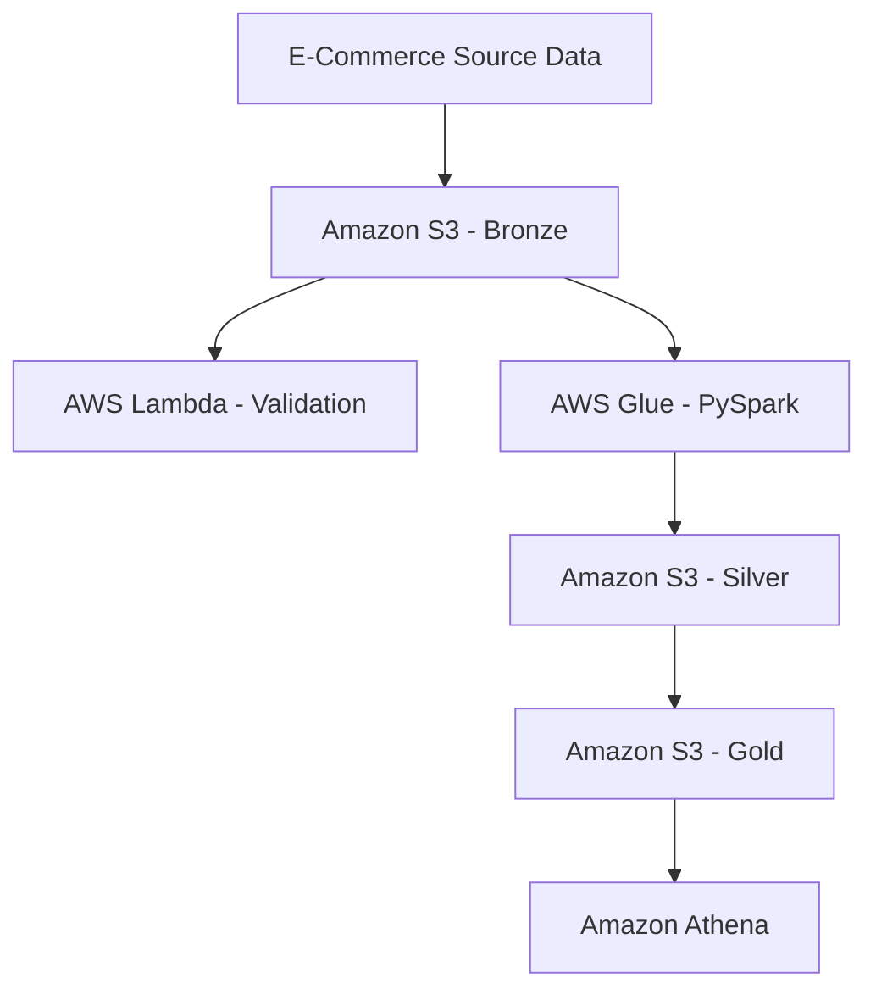

# ShopEasy AWS Data Engineering Architecture

This diagram illustrates the end-to-end Bronze–Silver–Gold data pipeline implemented using AWS services.

## Architecture Components

- **Bronze:** Raw CSV ingestion and AWS Lambda validation.
- **Silver:** AWS Glue PySpark ETL, cleansing, data-quality checks, and partitioned Parquet storage.
- **Quarantine:** Stores flagged records for investigation.
- **Gold:** Dimensional models, transaction facts, and analytics marts.
- **AWS Glue Data Catalog:** Metadata management and partition discovery.
- **Amazon Athena:** SQL analytics, data validation, and reconciliation.
